<div align="center">


# WorkMesh

**Know who's building what. Understand how it all connects.**

A multi-tenant company visibility platform for growing companies (≈20–150 people). WorkMesh connects people, teams, goals, projects, progress updates, blockers, dependencies and decisions in one permission-aware system — without surveillance.

[](https://github.com/Sreevarshann/workmesh-company-visibility-platform/actions/workflows/ci.yml)

</div>

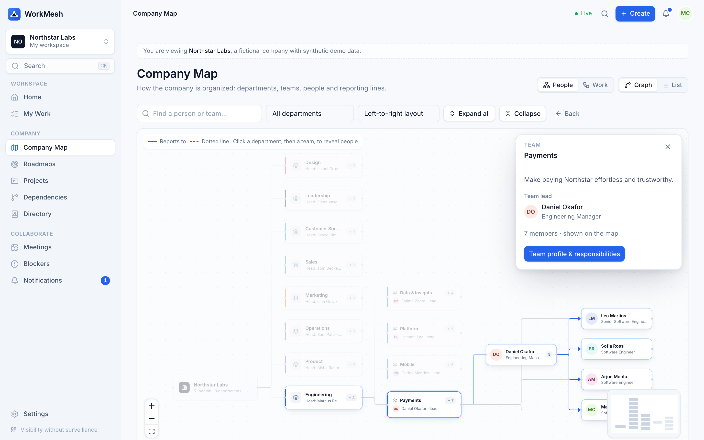

> All screenshots are real browser captures of the running app (Playwright). The data belongs to **Northstar Labs, a fictional company with synthetic demo data**.

---

## The problem

During an internship at a ~50-person company, managers didn't reliably know what their interns and engineers were working on, so people repeatedly re-explained their assignments, stage, progress, next steps and blockers. At the same time, most employees understood the work of maybe ten colleagues — the rest of the company was invisible. That produced status meetings, duplicate work, unclear ownership, dependency surprises and slow onboarding.

## Why WorkMesh exists

WorkMesh models the company as two connected structures — **Company → Departments → Teams → People** and **Goals → Initiatives → Projects → Milestones → Work items** — joined by ownership, membership, reporting lines, dependencies and progress updates. It answers, from real records:

- Who works here, how is the company organized, who manages whom?
- Which team owns what, and what is each person responsible for?
- Which goals does a project support, how far along is it, and what changed since last time?
- What is blocked, who owns the blocker, and which cross-team dependencies may delay a launch?
- What does a manager need to know before a meeting?
- **And for every one of those: what is *this* user legitimately allowed to see?**

Principles: visibility without surveillance; transparency without confidentiality leaks; progress measured by outcomes; permissions enforced on the server. WorkMesh has **no** activity tracking, keystroke/screen/webcam monitoring, online-time metrics or productivity scores. It does not use an LLM.

## Key features

| Area | What it does |
| --- | --- |
| **Interactive Company Map** | React Flow + ELK. People mode (company → departments → teams → people, reporting & dotted lines) and Work mode (goals → initiatives → projects → milestones, dependency edges). Progressive disclosure, search & jump, department/status filters, three layouts, reporting-subtree focus, back history, minimap, and an accessible tree-list alternative. Only server-authorized nodes are ever sent. |
| **Role-aware workspaces** | One app, five workspaces derived on the server from real relationships: Employee, Manager (Team Pulse), Project lead, Leadership, Admin. |
| **Progress updates** | Quick update in under a minute (focus, stage, next step), optional detail (completed, help needed from whom, confidence), audiences from *private draft* to *organization*, edit history, acknowledgements, comments, "I'm blocked" creates a tracked blocker atomically. |
| **Blockers** | Open → Assigned → Investigating/Waiting → Resolved (→ Reopened), validated transitions, owner assignment, mandatory resolution notes, full event timeline, linked work items pause and resume automatically, opt-in escalation. |
| **Roadmaps** | Timeline, board, sortable list, milestone tracker and goal hierarchy over the same records. Explainable health; computed progress kept separate from owner-reported estimates. |
| **Dependencies** | DAG with cycle prevention, explorer that separates **confirmed problems** from **potential downstream impact**, with paths and slack evidence — no deadline predictions. |
| **Meeting briefs** | Deterministic, per-viewer briefs of what changed since the last meeting (work done, milestones, new/unresolved blockers, status changes, deadlines, decisions required, help requests, open actions, missing information), each item linked to its source. Agenda, decisions, action items, recurring roll-forward, Markdown and print-to-PDF export. No recording or transcription. |
| **Directory & discovery** | People, teams searchable by responsibility, departments, team missions and points of contact. |
| **Notifications & realtime** | Transactional outbox → BullMQ → notifications re-authorized per recipient, deduplicated; Socket.IO pings to per-member rooms only; clients refetch through the authorized API. |
| **Search** | PostgreSQL full-text search with authorization applied in SQL, ⌘K palette. |
| **Administration** | Members & roles, invitations, teams & departments, reporting-line editor with history, delegations, a permission inspector that explains real policy decisions, audit log. |

## Employee workspace

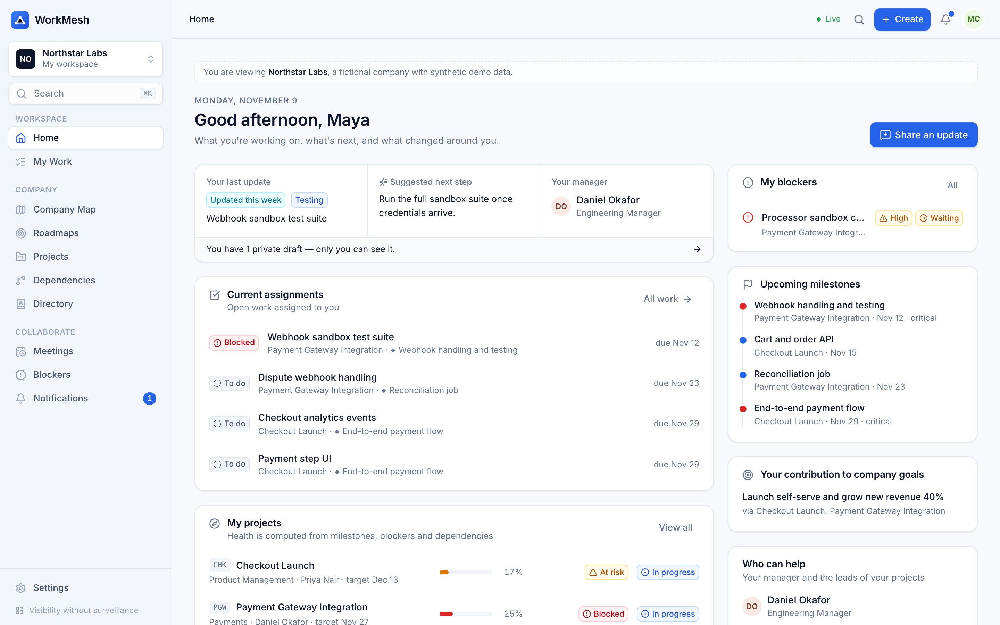

What am I working on, what's my stage, what's next, am I blocked, who can help, which goal does my work support, what is my team doing. The update composer:

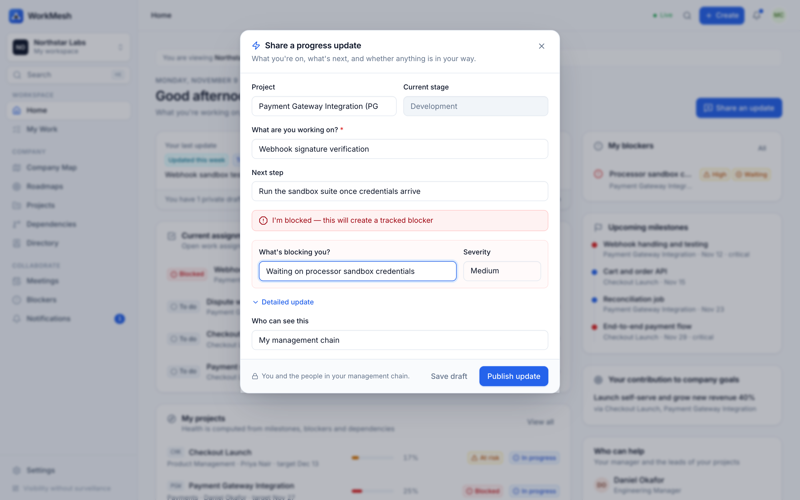

## Manager workspace — Team Pulse

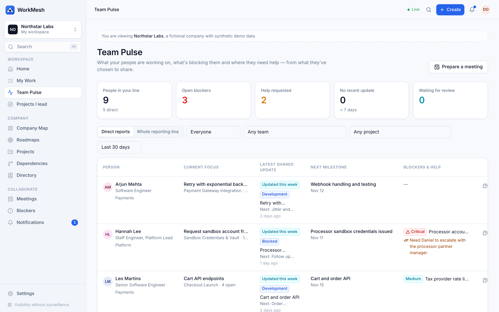

Each report's current focus, latest *shared* update with neutral freshness ("Updated this week", "No current update" — never "inactive"), next milestone, blockers and help requests; filters by team, project, status and period; ask for an update or assign a follow-up in one click. Blocker queue:

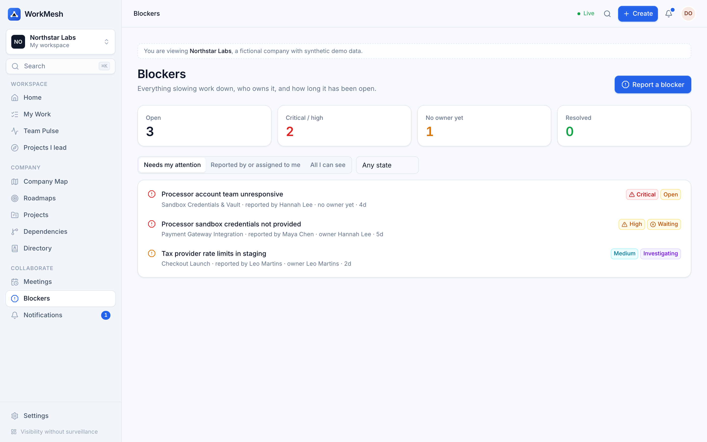 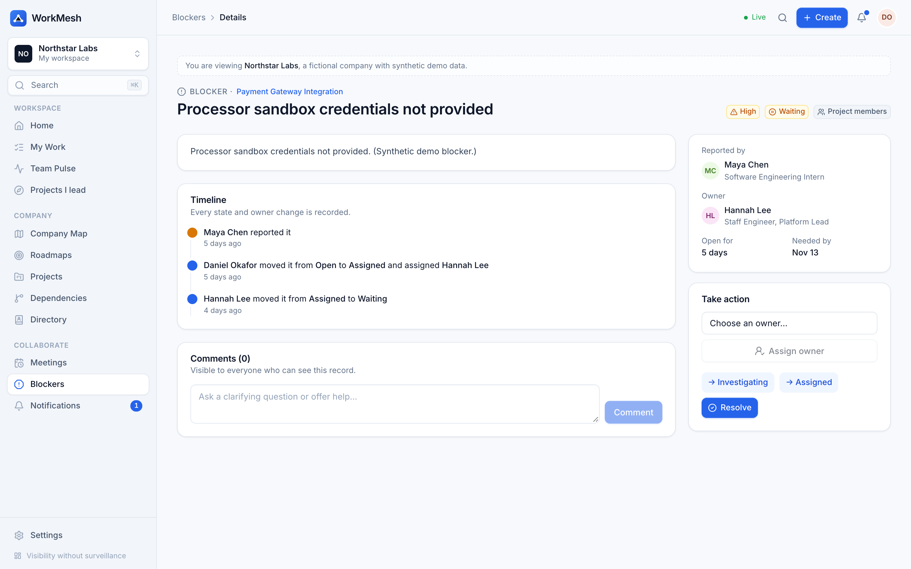

## Leadership workspace

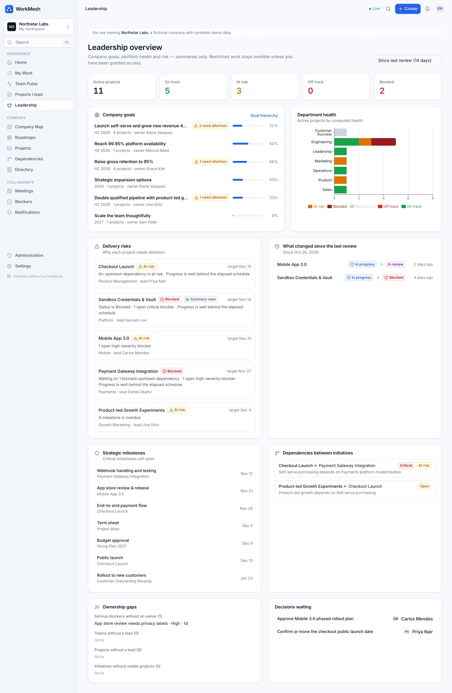

Goal progress, portfolio and department health, delivery risks *with the reasons*, changes since the last review, strategic milestones, cross-initiative dependencies, ownership gaps and pending decisions. Executives receive **summaries** of non-restricted projects — seniority never unlocks details.

## Company Map — Work view, roadmap and projects

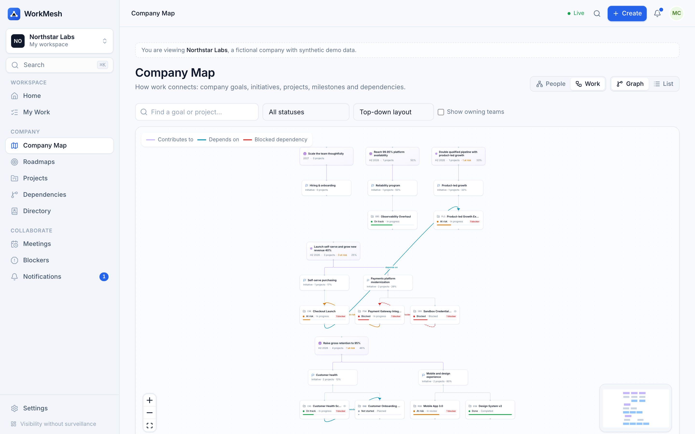
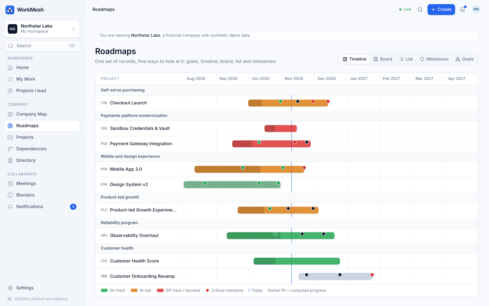
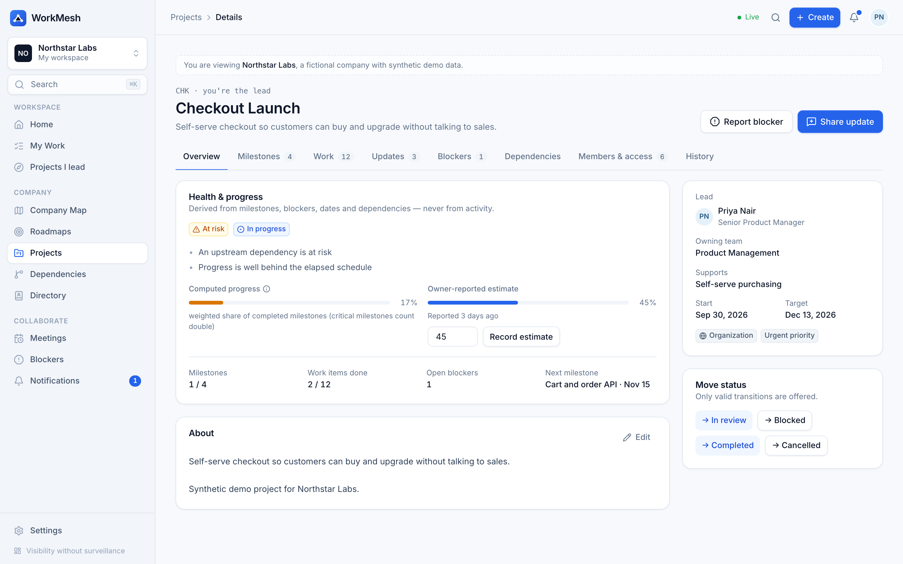
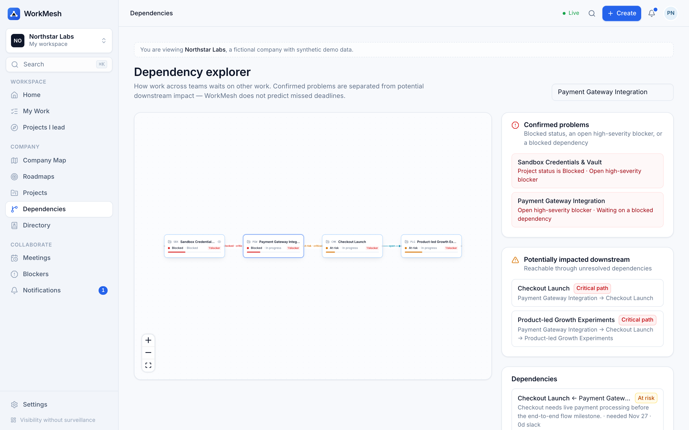
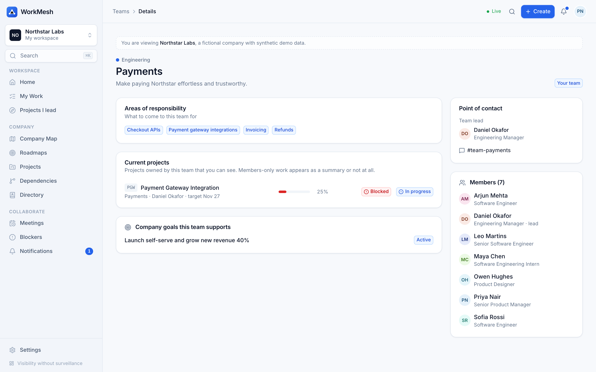

## Meeting Briefs

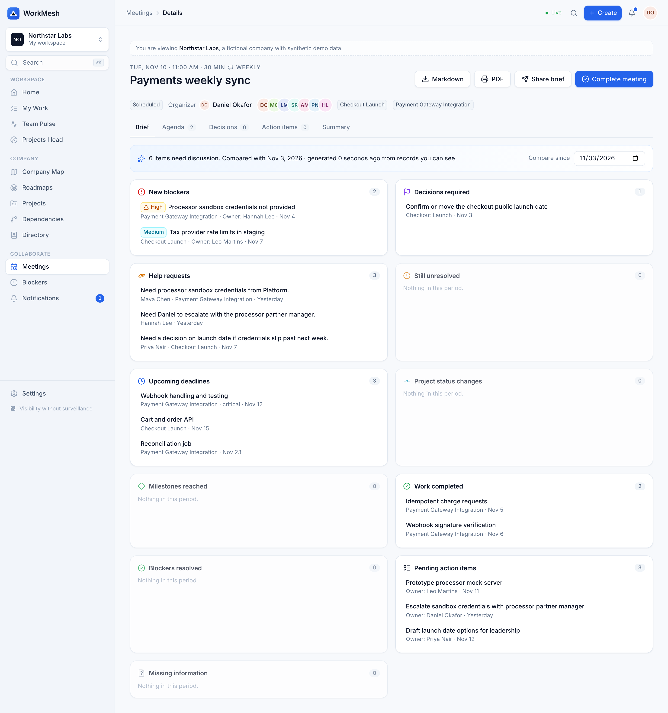

## Role-based permissions

| Persona (demo) | Sees | Does not see |
| --- | --- | --- |
| **Employee** — Maya Chen, intern | Own work & drafts, teammates' team-visible updates, org-visible projects in detail, *summaries* of discoverable members-only projects | Team-only projects of other teams, members-only non-discoverable projects, the restricted acquisition project (no name, count, edge or search hit), anyone's drafts |
| **Manager** — Daniel Okafor | Updates shared with his management line (direct + indirect + delegated), Team Pulse, blockers of reports on projects he can see | His reports' private drafts; updates about projects he can't see in detail |
| **Project lead** — Priya Nair | Full details of the project she leads, contributors' project-visible updates even though they don't report to her | Team Pulse (no reports) |
| **Executive** — Elena Vasquez (owner) | Portfolio-wide summaries, goals, risks; details only where she has a relationship | Details of projects she isn't on — "executive" grants summaries, not content |
| **Org admin** — Sam Patel | Members, invitations, structure, reporting, audit, permission inspector | Confidential project content — admin is configuration power, not content access |

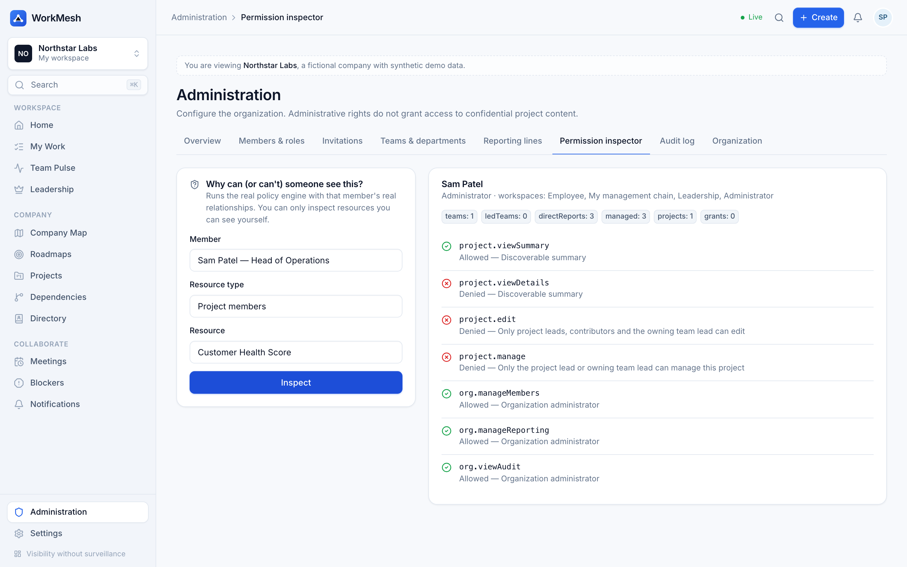
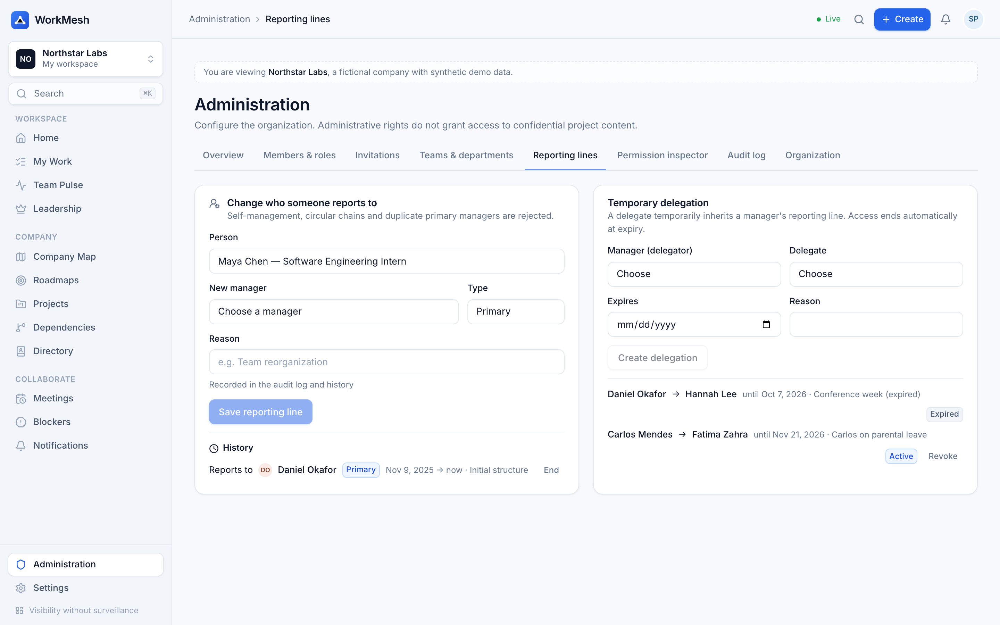

## System architecture

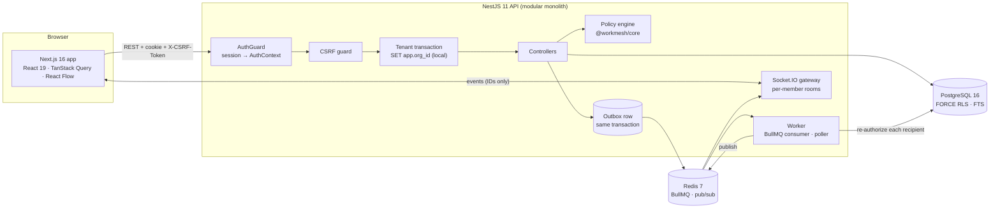

Details: [ARCHITECTURE](docs/ARCHITECTURE.md) · [DATABASE](docs/DATABASE.md) · [AUTHORIZATION](docs/AUTHORIZATION.md) · [TENANCY](docs/TENANCY.md) · [EVENTS](docs/EVENTS.md) · [ORGANIZATION_GRAPH](docs/ORGANIZATION_GRAPH.md) · [ROADMAPS](docs/ROADMAPS.md) · [PROGRESS_UPDATES](docs/PROGRESS_UPDATES.md) · [MEETINGS](docs/MEETINGS.md) · [SECURITY](docs/SECURITY.md) · [TESTING](docs/TESTING.md) · [DECISIONS](docs/DECISIONS.md) · [DEPLOYMENT](docs/DEPLOYMENT.md) · [DEMO](docs/DEMO.md)

## Technology stack

**Frontend** Next.js 16 (App Router) · React 19 · TypeScript (strict) · Tailwind CSS 4 · Radix UI primitives in a shadcn-style component layer · React Flow (@xyflow/react) + ELK.js · TanStack Query & Table · Zustand · React Hook Form · Recharts · cmdk · Lucide · date-fns · Socket.IO client
**Backend** Node.js 22+ · NestJS 11 · Prisma 6 · PostgreSQL 16 (RLS, full-text search) · Redis 7 · BullMQ · Socket.IO · Zod · Argon2id · Pino · prom-client · Swagger (dev)
**Shared** `@workmesh/core` — pure TypeScript policy engine, graph algorithms, state machines, health and brief logic used by API and web
**Quality** Vitest · Jest + Supertest · Playwright · ESLint · GitHub Actions · Gitleaks · pnpm audit · Docker

## Database design

35 tenant tables, each carrying `organizationId` and protected by `FORCE ROW LEVEL SECURITY` for the restricted `workmesh_app` role; global tables (`users`, `sessions`, reset tokens, mailbox) have no grants for that role at all. Integrity rules Prisma can't express live in SQL: one pending invitation per email, one active primary manager per person, no self-management, no self-dependencies, value ranges. Reporting lines, blocker events, update revisions and field-level change events are append-only history. See [docs/DATABASE.md](docs/DATABASE.md).

## Authorization architecture

A single, pure, deny-by-default policy engine (`packages/core/src/policy.ts`) combines **RBAC** (owner/admin/executive/member), **ReBAC** (reports-to transitively, team membership/leadership, department headship, project membership/leadership, delegations, explicit grants) and **ABAC** (tenant, visibility classification, discoverability, membership status, grant/delegation expiry). Projects have three access levels — `none`, `summary`, `details`. The API builds an `AuthContext` once per request, cached by `(org, member, org.authzVersion)`; every write that changes who can see what bumps `authzVersion` in the same transaction, so revocation is immediate. List endpoints pre-filter in SQL with the same sets and re-check every row. See [docs/AUTHORIZATION.md](docs/AUTHORIZATION.md).

## Local setup

Requirements: Node 22+ (corepack), Docker. Ports: web **3002**, API **8020**, Postgres **55462**, Redis **56402** (all bound to 127.0.0.1, isolated compose project `workmesh`).

```bash
make setup   # .env from .env.example, install, start Postgres + Redis, migrate, seed demo data
```

```bash
make dev     # API on http://localhost:8020 (Swagger at /api/docs), web on http://localhost:3002
```

Other targets: `make up`, `make down`, `make seed`, `make test`, `make lint`, `make typecheck`, `make build`, `make e2e`, `make screenshots`, `make demo`.

## Demo personas

Sign in at http://localhost:3002/login. With `DEMO_MODE=true` (local only — the API refuses to start with it in production) the login page offers one-click personas: **Employee** (Maya Chen), **Manager** (Daniel Okafor), **Project lead** (Priya Nair), **Executive** (Elena Vasquez), **Org admin** (Sam Patel). A random password for all demo users is generated on every `make seed` and written to the git-ignored `.demo-credentials.json`. A second tenant, **Meridian Systems** (`noah.berg@meridian.example`), exists to demonstrate isolation. Walkthroughs: [docs/DEMO.md](docs/DEMO.md).

## Tests

| Suite | Tool | Count | Result (local, 2026-11-09) |
| --- | --- | ---: | --- |
| Domain core: policy matrix, hierarchy & DAG algorithms, state machines, health, briefs, dedupe | Vitest | 91 | ✅ 91 passed |
| API integration on real Postgres + Redis: tenancy & RLS (10), authorization matrix (27), workflows/journeys (13), realtime sockets (3) | Jest + Supertest + socket.io-client | 53 | ✅ 53 passed |
| Web components & client | Vitest + Testing Library | 16 | ✅ 16 passed |
| Critical journeys A–G against the full stack | Playwright | 7 | ✅ 7 passed |

Measured API latency (300 requests/endpoint, concurrency 10, seeded Northstar data of 51 people / 12 projects / 98 work items; MacBook Apple Silicon 10-core 16 GB, API in dev mode with pretty logging, Postgres & Redis in Docker):

| Endpoint | p50 ms | p95 ms | p99 ms | req/s |
| --- | ---: | ---: | ---: | ---: |
| Health (DB + RLS + Redis + queue checks) | 15.8 | 59.5 | 108.9 | 478 |
| Employee dashboard | 80.2 | 101.5 | 174.2 | 118 |
| Team Pulse | 68.9 | 121.7 | 138.3 | 129 |
| Leadership dashboard | 83.3 | 164.2 | 252.3 | 105 |
| Project list with health | 32.7 | 38.0 | 40.5 | 298 |
| People graph, every team expanded | 54.0 | 63.7 | 68.5 | 182 |
| Work graph | 39.8 | 53.7 | 57.6 | 242 |
| Update feed (policy-filtered) | 31.0 | 37.5 | 39.4 | 314 |
| Full-text search | 54.9 | 62.6 | 88.2 | 177 |

Zero errors. API RSS ≈ 79 MB idle, up to ≈ 440 MB during the run, back to ≈ 79 MB when idle (heap growth reclaimed, not a leak). Reproduce with `pnpm --filter @workmesh/api loadtest`. These numbers are for this dataset and machine only.

## CI/CD

GitHub Actions ([ci.yml](.github/workflows/ci.yml)): lint + typecheck + core unit tests · API integration & authorization suites against Postgres 16/Redis 7 service containers with the RLS role · web unit tests + production build · Playwright journeys · Docker builds of both images · Gitleaks over full history · production dependency audit.

## Security model

Opaque 256-bit session tokens in HTTP-only `SameSite=Lax` cookies (only SHA-256 hashes stored) · CSRF double-submit + Origin check · Argon2id passwords · rate-limited auth endpoints · Zod validation on every input · deny-by-default policy engine + PostgreSQL RLS · 404 for anything you may not see (no existence probing) · `Cache-Control: private, no-store` on API responses · Helmet + CSP on the web app · audit log without free-text content or secrets · request bodies never logged · notifications/realtime re-authorized per recipient and carry no confidential names. Threat model: [docs/SECURITY.md](docs/SECURITY.md).

## Known limitations

- Single-region modular monolith; the in-process AuthContext cache and Throttler store are per instance (use Redis-backed storage when running several API instances).
- PDF export uses the browser's print-to-PDF with a print stylesheet; there is no server-rendered PDF.
- Email is a local developer mailbox; a real SMTP/API transport is not wired up.
- No file attachments; "related work" links point to WorkMesh records only.
- Restricted-goal visibility is binary (owner/grant); per-field ABAC policies are not user-configurable yet.
- Mentions (`@name`) aren't parsed; "help needed from" is the explicit mention mechanism.
- The API image keeps full dependencies (≈ 900 MB) so migrations can run from it; a slimmer runtime image is future work.
- Not deployed publicly — runs locally and in CI only.

## Future roadmap

1. Calendar integration (read-only) to create meeting briefs automatically for recurring syncs.
2. Configurable visibility policies per resource field, and organization-level default audiences.
3. SSO (OIDC/SAML) and SCIM provisioning for directory sync.
4. Slack/Teams digest delivery of briefs and blocker escalations (opt-in, payloads re-authorized).
5. Historical health trends per project and goal, computed from change events.

---

Built by [Sreevarshann](https://github.com/Sreevarshann). Synthetic demo data only — no real company or person is depicted.
