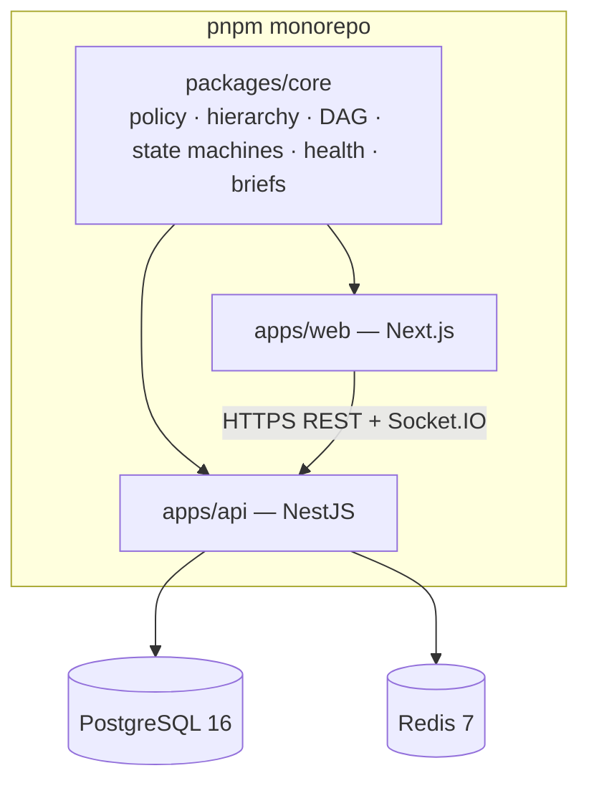
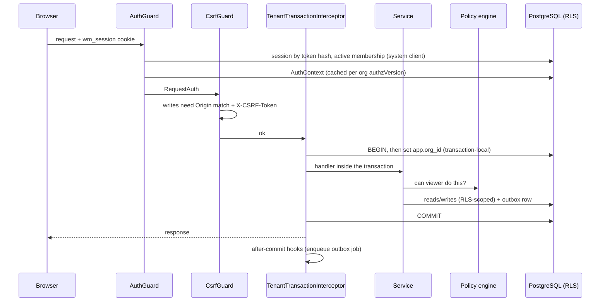

# Architecture

WorkMesh is a **modular monolith**: one NestJS API process (optionally with a separate worker process), one Next.js web app, one shared pure-TypeScript domain package, PostgreSQL and Redis. Microservices were deliberately avoided — the target is 20–150-person companies and a laptop-friendly developer setup.

## Packages

| Path | Responsibility |
| --- | --- |
| `packages/core` | Framework-free logic shared by API and web: `policy.ts` (authorization), `hierarchy.ts` (reporting graph), `dependencies.ts` (DAG + impact), `transitions.ts` (state machines), `health.ts` (progress & health), `brief.ts` (meeting briefs), `notifications.ts` (dedupe keys), `enums.ts`. 91 unit tests. |
| `apps/api/src/common` | Request pipeline: `Db` (two Prisma clients + `runAsTenant`), `AuthGuard`, `CsrfGuard`, `TenantTransactionInterceptor`, outbox `EventsService`, `AuditService`, `QueueService`, metrics, error filter, Zod pipe. |
| `apps/api/src/modules/*` | Feature folders: `auth`, `org`, `policy`, `work` (goals/projects/milestones/work items), `updates` (updates, blockers), `graph` (Company Map, dependencies), `meetings`, `notifications` (delivery worker, realtime), `search`, `dashboard` (workspaces, directory, admin), `health`, `dev`. |
| `apps/web/src/app` | Route groups `(auth)` (sign-in flows) and `(app)` (authenticated shell), plus `/dev/mailbox`. |
| `apps/web/src/components` | `ui` (Radix-based primitives), `shell`, `map`, `project`, `meetings`, `work`. |

## Request lifecycle

Every organization-scoped request is **one database transaction** in which `app.org_id` is set transaction-locally. Consequences: all reads are tenant-confined by PostgreSQL itself, multi-record writes are atomic, and outbox events commit with the change that produced them.

## Background processing & realtime

See [EVENTS.md](EVENTS.md). Durable changes write an `outbox_events` row; after commit a BullMQ job (jobId = outbox id) is enqueued; a poller re-enqueues anything committed but undelivered. The worker re-authorizes each recipient, writes deduplicated notifications, then publishes a Redis message that the Socket.IO gateway fans out to per-member rooms. Clients refetch through the REST API.

The worker runs inside the API process by default (`WORKER_INLINE=true`) or standalone (`node dist/worker.js`).

## Frontend

- **Data**: TanStack Query keyed by API path; `useAction` wraps mutations with toasts, server error messages and invalidation. Realtime events invalidate path prefixes.
- **State**: Zustand for UI-only state (workspace preference, composer, palette, recents). Authorization never depends on client state.
- **Graph**: React Flow with custom nodes and ELK layouts (`layered` down/right, `mrtree`). The map list view renders the same authorized graph as an ARIA tree.
- **Design system**: Tailwind 4 tokens in `globals.css`; primitives in `components/ui` follow the shadcn pattern (copied-in components on Radix).

## Observability

Pino structured logs with request ids (`x-request-id` propagated, also stored on outbox rows and audit events as the correlation id), redacted cookies/authorization, no bodies. `/api/health` verifies Postgres, that RLS is enforced for the app role, Redis and queue counts. `/api/metrics` (bearer token) exposes request latency, job duration, job failures, notifications delivered and realtime messages.
