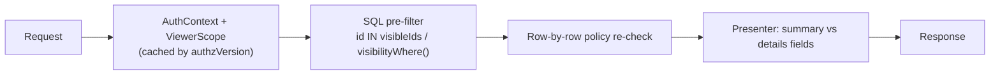

# Authorization

One policy decision point: [`packages/core/src/policy.ts`](../packages/core/src/policy.ts). It is pure (no I/O), deny-by-default, and returns `{ allow, reason }` so decisions can be explained (the admin permission inspector shows these reasons verbatim).

## Inputs

```ts
interface AuthContext {
  orgId; userId; membershipId; role: "OWNER" | "ADMIN" | "EXECUTIVE" | "MEMBER"; active;
  teamIds; ledTeamIds; headedDepartmentIds;          // structure
  directReportIds; managedMemberIds; teammateIds;    // relationships (managed = transitive, incl. dotted lines + active delegations)
  projectRoles: Map<projectId, "LEAD" | "CONTRIBUTOR" | "VIEWER">;
  grants: Map<"PROJECT:<id>", "SUMMARY" | "DETAILS">; // non-expired, non-revoked
}
```

Built by `AuthzService` (`apps/api/src/modules/policy/authz.service.ts`) with ~11 queries, then cached.

## Models combined

- **RBAC** — org role: admins configure, executives get portfolio summaries.
- **ReBAC** — reports-to (transitive), team membership/lead, department head, project membership/lead, delegation, explicit grant.
- **ABAC** — tenant, visibility classification, `discoverable`, membership status, grant/delegation expiry.

## Visibility classifications

| Classification | Details visible to | Summary visible to |
| --- | --- | --- |
| `ORG` | everyone in the org | — |
| `TEAM` | owning team, owning department head, members, grants | executives, discoverable → everyone |
| `PROJECT_MEMBERS` | members, lead, `DETAILS` grants | executives, department head, discoverable → everyone |
| `RESTRICTED` | members, lead, `DETAILS` grants | `SUMMARY` grants only — otherwise invisible everywhere |

Updates and blockers have audiences: `PRIVATE` (author only), `MANAGER` (author's management line), `PROJECT`, `TEAM`, `ORG`. Drafts are always author-only. **An update or blocker linked to a project additionally requires details access to that project** (except for its author/owner), so a manager cannot learn about a confidential project through a report's update.

## Key rules (each covered by tests)

1. Tenant mismatch or inactive membership → deny.
2. Admin power is configuration, not content (`admin → TEAM project = none`).
3. Seniority grants summaries, never details; restricted stays invisible to executives.
4. A project lead sees contributor updates without managing them (Example C).
5. Removing a project member or revoking a grant/delegation takes effect on the next request (Examples E, F).
6. Only authors edit updates; only owners grant the owner role; the last owner can't be removed.

## Capability API

`projectAccess`, `canViewProject`, `canViewProjectDetails`, `canEditProject`, `canManageProject`, `canCreateProject`, `canViewGoal`, `canEditGoal`, `canCreateGoal`, `canViewUpdate`, `canEditUpdate`, `canViewBlocker`, `canManageBlocker`, `canViewMemberWork`, `canManageTeamMembership`, `can(ctx, "org.*")`, `canChangeRole`, `canViewMeeting`, `canEditMeeting`, `authorizedWorkspaces`.

## Enforcement pattern



`ViewerScope` precomputes `projectId → summary|details` for the org, so list endpoints filter in SQL. Functions like `UpdatesService.visibilityWhere()` mirror the policy predicate in Prisma; every row is still re-checked with the pure function, so a divergence could only hide rows, never reveal them. Anything the viewer can't see returns **404**, identical to a missing record.

## Cache invalidation

`organizations.authzVersion` is incremented in the same transaction as any change that affects access: memberships, roles, teams, department heads, reporting lines, delegations, project membership/lead/team/visibility, grants, goal visibility, project creation. Each request reads the version (one indexed lookup); a mismatch rebuilds the context. Entries also expire at the earliest grant/delegation boundary (or 60 s).

## Workspaces

`authorizedWorkspaces(ctx)`: employee always; manager if anyone is managed (incl. delegation); lead if leading a project or team; leadership if executive/owner or department head; admin if admin/owner. The UI's workspace switcher shows only these, and each workspace endpoint re-checks.

## Tests

- `packages/core/src/policy.test.ts` — 44 cases across 11 personas × 4 projects × actions.
- `apps/api/test/authorization.int.spec.ts` — 27 API-level cases on seeded data (Examples A–F, search/graph/export/dependency filtering, restricted goals, admin-only endpoints, inspector probing, workspaces, CSRF).
