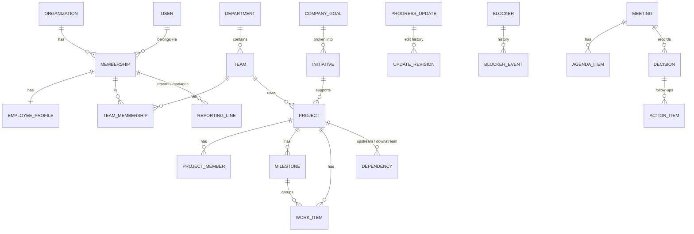

# Database

PostgreSQL 16, managed with Prisma 6 migrations (`apps/api/prisma`). Schema: [`schema.prisma`](../apps/api/prisma/schema.prisma). Security and search layer: [`20261109034700_security_search/migration.sql`](../apps/api/prisma/migrations/20261109034700_security_search/migration.sql).

## Entity overview

Tables (snake_case): `organizations`, `memberships`, `employee_profiles`, `positions`, `invitations`, `departments`, `teams`, `team_memberships`, `reporting_lines`, `delegations`, `company_goals`, `initiatives`, `projects`, `project_members`, `access_grants`, `milestones`, `work_items`, `change_events`, `progress_updates`, `update_revisions`, `update_acknowledgements`, `comments`, `blockers`, `blocker_events`, `dependencies`, `meetings`, `meeting_participants`, `meeting_projects`, `agenda_items`, `decisions`, `action_items`, `notifications`, `notification_preferences`, `outbox_events`, `audit_events` — plus global `users`, `sessions`, `password_reset_tokens`, `mail_messages`.

## Design rules

- **Every tenant table carries `organizationId`** (denormalized on purpose) so RLS needs no joins and every index can lead with it.
- **People are memberships.** A `Membership` is a user inside one organization; profiles, reporting, teams and projects reference memberships, so one user can belong to several companies with different roles.
- **History is append-only.** Reporting lines are ended (`endedAt`) not deleted; blockers keep `blocker_events`; published updates keep `update_revisions`; projects, milestones and work items emit field-level `change_events` that power briefs and history views.
- **Optimistic concurrency.** `projects`, `milestones`, `work_items`, `progress_updates` and `blockers` carry `version`; writes use `UPDATE … WHERE id = ? AND version = ?` and return 409 when nothing matched.

## Constraints Prisma can't express (SQL)

| Constraint | Purpose |
| --- | --- |
| `invitations_one_pending_per_email` — unique `(organizationId, lower(email)) WHERE status = 'PENDING'` | No duplicate pending invites |
| `reporting_one_active_primary` — unique `(reportId) WHERE type='PRIMARY' AND endedAt IS NULL` | At most one active primary manager |
| `reporting_no_duplicate_active`, `team_membership_one_active` | No duplicate active lines/memberships |
| `reporting_not_self`, `delegation_not_self`, `delegation_window`, `dependency_not_self` | Structural sanity |
| `update_confidence_range` (1–5), `project_reported_progress_range` (0–100) | Value ranges |

Cycle detection (reporting chains, dependency DAG) happens in the application with graph algorithms because it requires reachability, not a row-level check.

## Row-Level Security

See [TENANCY.md](TENANCY.md). In short: two roles — `workmesh_owner` (migrations, global tables) and `workmesh_app` (`NOBYPASSRLS`). Every tenant table has `FORCE ROW LEVEL SECURITY` and policy `tenant_isolation USING (org_col = wm_current_org()) WITH CHECK (same)`, where `wm_current_org()` reads the transaction-local `app.org_id`. The app role has **no grants** on `users`, `sessions`, `password_reset_tokens` or `mail_messages`.

## Full-text search

GIN expression indexes using `to_tsvector('simple', …)` (no stemming — names and jargon matter) on profiles, teams, departments, projects, goals, initiatives, milestones, updates, blockers and decisions. An `IMMUTABLE` helper `wm_join(text[])` makes array columns indexable. Queries use prefix `tsquery` (`pay:* & gate:*`) and are restricted to visible IDs in the same SQL statement.

## Indexes

Composite indexes lead with `organizationId` for the hot paths: memberships by status, team memberships by member, reporting lines by `endedAt`, projects by status/team, work items by project+status and assignee, updates by author/project/status+`publishedAt`, blockers by state/project/owner/reporter, notifications by recipient+read+created, change events by project+created, audit by created.

## Migration strategy

`prisma migrate deploy` applies migrations in order, as the owner role, as a separate release step (never on API boot). New migrations are generated with `prisma migrate diff`, reviewed, and must preserve the hand-written SQL above (Prisma does not model partial/expression indexes — review diffs so they aren't dropped).
