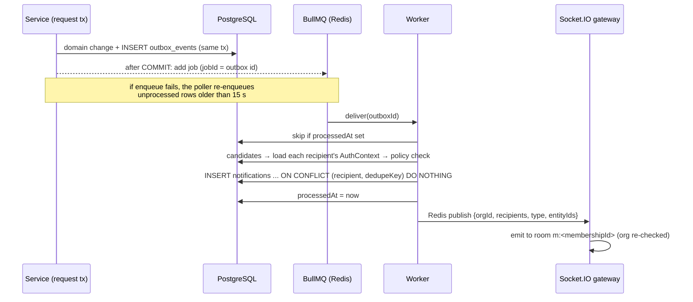

# Events, notifications, realtime & auditing

## Transactional outbox

Event types: `update.published|acknowledged|requested`, `comment.added`, `blocker.created|assigned|changed|escalated`, `project.changed|member_added`, `milestone.changed`, `workitem.changed`, `dependency.changed`, `decision.recorded`, `action_item.assigned`, `meeting.brief_ready|changed`.

## Guarantees

- **No lost events** — the outbox row commits with the change; delivery is retried by BullMQ (5 attempts, exponential backoff) and by the poller (up to 8 attempts). If Redis is down, the poller delivers directly.
- **Idempotent** — `processedAt` guard plus a unique `(recipientId, dedupeKey)`. Dedupe keys are `TYPE:entity:eventId`, or a time bucket for noisy types (e.g. blocker changes collapse per hour, deadline reminders per day). Tested by re-delivering a processed event.
- **Authorized payloads** — every candidate recipient is re-checked with *their own* AuthContext against the actual record. Titles include a project name only when that recipient has details access.
- **Realtime is a hint** — payloads contain event types and IDs only; clients invalidate queries and refetch through the authorized API. On reconnect the client resynchronizes everything. Durable state stays in Postgres.

## Notification preferences

Per member and type (`notification_preferences.inApp`). Muted types skip the notification row but still send the realtime refresh for pages the member is viewing.

## Correlation

The request id (`x-request-id`) is stored on outbox rows (`correlationId`) and audit events (`requestId`), passed into the worker's tenant context and included in realtime payloads — one id traces a workflow through API, database, worker and socket.

## Audit log

`audit_events` rows are written in the same transaction as the change: actor, tenant, action, resource, request id and sanitized metadata (structural before/after values). A sanitizer drops keys matching `password|token|secret|hash|csrf` and truncates long strings; free-text update/comment content is not stored. Covered actions include organization creation/settings, invitations, membership role/status, reporting and delegation changes, department/team changes, project create/update/status/progress/members/grants, milestone and work-item changes, edits of published updates, blocker create/assign/state/resolve, decisions, action items and meetings.
